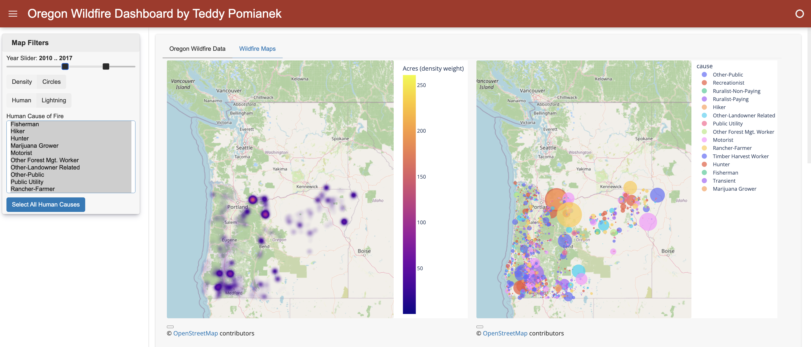

# Oregon Wildfire Dashboard

An interactive dashboard for exploring the location, size, and cause of Oregon wildfires from 2000 to 2022. Built with Python, HoloViz Panel, and Plotly.



## Overview

The dataset from the Oregon Department of Forestry records over 23,000 wildfires with their coordinates, estimated acreage, and cause. This dashboard focuses on the `CauseBy` field, which breaks human caused fires into specific categories (motorist, recreationist, debris burning, and more), and connects how a fire started to where it happened and how large it grew.

Questions the dashboard helps answer:

- Which parts of the state see the largest fires?
- What are the primary human causes of wildfires in Oregon?
- How have ignition sources changed over time?

## Features

- **Year range slider** to filter both maps by time period
- **Density map** where hotter colors mark areas with larger and more tightly clustered fires
- **Circle map** where marker size scales with acres burned
- **Cause map** colored by specific human cause
- **Human vs. Lightning toggle**
- **Multiselect for human causes**, plus a Select All button
- **Data table tab** with the full cleaned dataset, paginated

## Project Structure

```
oregon-wildfire-dashboard/
├── fire_panel.py          # Widgets, map builders, callbacks, and layout
├── wildfire_api_ted.py    # FIREAPI class: loads, cleans, and filters the data
├── data/
│   └── ODF_Fire_Occurrence_Data_2000-2022.csv
├── docs/
│   └── poster.pdf         # Project poster
├── requirements.txt
└── README.md
```

## Data Cleaning

`FIREAPI.load_data()` keeps six columns (year, acres, cause type, specific cause, latitude, longitude), drops rows with missing values, converts numeric fields, removes fires with 0 recorded acres, and sorts by year. Acreage is square root scaled for map weights and marker sizes so small fires stay visible next to very large ones.

## How to Run

```bash
git clone https://github.com/YOUR_USERNAME/oregon-wildfire-dashboard.git
cd oregon-wildfire-dashboard
pip install -r requirements.txt
python fire_panel.py
```

The dashboard opens in your browser. You can also run it with `panel serve fire_panel.py --show`.

## Tech Stack

Python, pandas, HoloViz Panel, Plotly Express (Mapbox density and scatter maps)

## Data Source

[ODF Fire Occurrence Data 2000-2022](https://catalog.data.gov/dataset/odf-fire-occurrence-data-2000-2022), Oregon Department of Forestry, via Data.gov

## Author

Teddy Pomianek, Northeastern University (B.S. Data Science and Economics)
